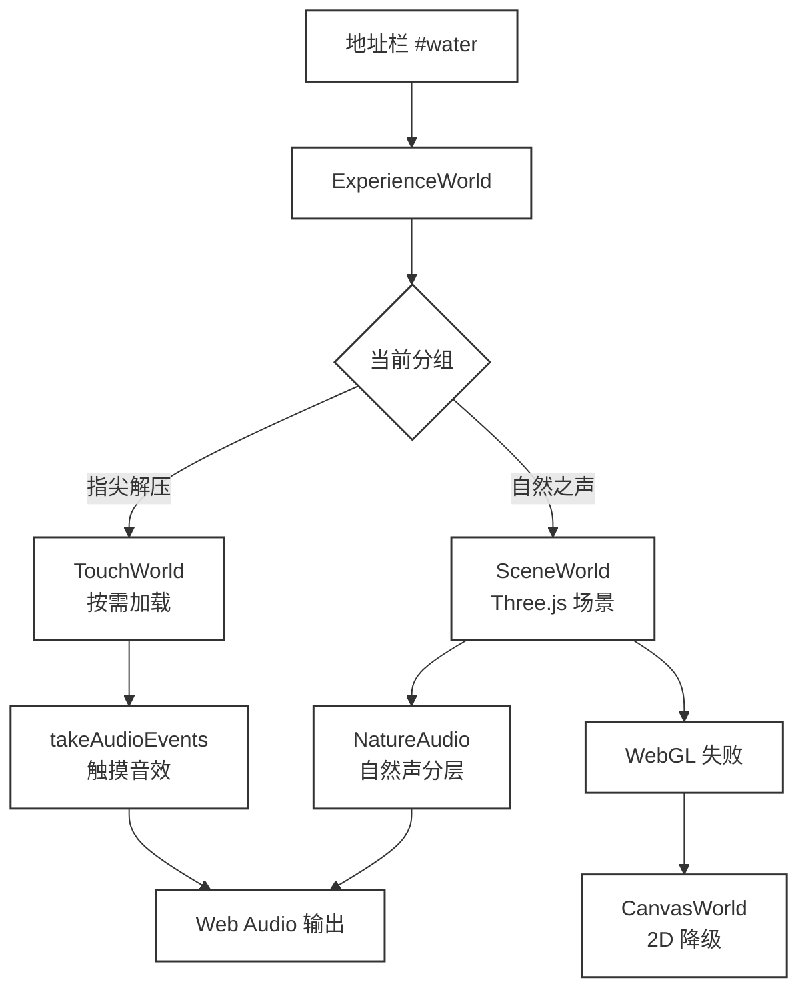

# 做了个用来放松的网站：8 种白噪音，外加划水、捏泡泡、滑沙

Vibe了个网站，叫轻境 Calmscape。打开之后没有登录、没有广告、没有「开通会员才能听完整版」的弹窗，只有八个自然场景和八个指尖解压的小工具。

做这个的出发点比较简单，可以在上班的时候更专心的摸鱼。

能听见风、雨、火堆的声音，也可以随便划两下、捏捏电子泡泡，直接使用Cloudflare进行部署，纯前端，配个域名就行：

- 访问：https://calm.ppai.top/
- 如果上面的访问有问题，也可以直接访问：https://calm-bqi.pages.dev/

## 01、白噪音不缺，缺的是手上那点事

市面上的白噪音工具很多。随便搜一搜，雨声、海浪、篝火、咖啡馆，几乎能想到的声音都有。我想做点不一样的，可以在听声的同时，也可以划划水，在思考的时候，也可以让无处安放的手有一个落脚点

所以在Clamscap轻境的实现中也很简单直接，给每个自然场景配一个可以简单交互的方案：

比如麦田可以划拉一下，池塘可以点点涟漪，篝火可以添写木头，雪地上可以画一画

就简单动一动，不需要目的，也不需要上下文，同样没什么限制，想干嘛就干嘛，比如夜间田园这个，点点小青蛙也挺有意思

此外，这个网站我希望足够简单，打开即用，所以不要账号，也不加任何限制。所有的偏好都存在本地，打开就能用，关掉就走。没有云端同步，也没有跨设备记录，简简单单就好。

## 02、八个自然场景，各自管一种情绪

白噪音，总共设计了八个典型的场景，覆盖“风吹雨打、雪飘叶落”

名字也很直白，麦田吹风、雨落池塘、静静落雪、篝火时光、林间鸟语、海边听浪、风铃小院、夜间田园。

每个场景一张静态壁纸 + 一些可以交互的小细节：背景、天气、环境粒子、声音强度会跟着场景走，鼠标或手指在画面上移动，也会改变局部的动态。

| 场景 | 声音 | 适合 | 示意图 | 
| --- | --- | --- | --- |
| 麦田吹风 | 风声、麦浪 | 想放空，又不想完全安静 |  |
| 雨落池塘 | 雨声、水波 | 写东西、看书 |  |
| 静静落雪 | 很轻的环境声 | 需要低刺激 |  |
| 篝火时光 | 柴火噼啪 | 晚上，想有点陪伴感 |  |
| 林间鸟语 | 鸟鸣、树叶 | 白天，需要一点生气 |  |
| 海边听浪 | 海浪 | 午休、发呆 |  |
| 风铃小院 | 风铃 | 短休息 |  |
| 夜间田园 | 虫鸣、蛙声 | 睡前，关灯之后 |  |

雨落池塘适合需要一点白噪音但不想太吵的时候。点一下水面，涟漪从落点散开；按住拖动，水波会被推着走，雨声也跟着密一点。

静静落雪的动态最少。雪花慢慢落，按住画面轻划，雪面会留下痕迹，过一会儿又被新雪盖住。

林间鸟语的重点在鸟。小鸟会在不同的枝叶上跳跃，点击小鸟也可以让小鸟自由的飞起来；在界面中，也会有叶子会慢慢飘下来。

海边听浪这一个设计得比较拉跨，现在的实现距离我的预期相差甚远。

风铃小院适合很短的空隙。点一下铃管，声音很轻；手指从铃管上划过，会带起一串风。

麦田吹风的回应最直接。鼠标从左划到右，麦浪跟着动，风的声音也会有一点变化。

篝火时光适合晚上。点一下火堆，会添一根柴，木头慢慢变黑，火星顺着光标往上飘。

点柴和火星都有单独的声音，不是一段循环播放的火焰视频。

夜间田园有一个小彩蛋。点水边的青蛙，它会叫一声。声音不大，但在虫鸣里很清楚。

## 03、划水、捏泡泡、滑沙，手感从哪来

指尖解压一共八个工具。划水、捏泡泡、滑沙是最常用的三个，也是我最开始想做的三个。

它们有一个共同点，动作都很短，回应都很直接。不用学规则，不用看说明，手指放上去就知道该怎么玩。

### 划水

水面是一层会动的波纹。手指轻轻移动，水面被拨开。

按住不放再拖，会带出一条尾波；点一下，水花往里陷，涟漪一圈一圈散开。

水感滑杆控制的是波纹的幅度。往左调，水面很克制；往右调，波纹会明显一些。

这个里面我比较喜欢的就是划水的声音，太适合“划水”的时候了😊

### 捏泡泡

泡泡纸是一整张。手指按下去，泡泡先凹，再啪地破掉。按住划过，可以连续捏一排。

泡泡有两种材质，塑料泡泡和水泡泡。两种材质的视觉和声音不一样，塑料的更脆，水泡泡更软。

本来是准备做一个全屏的泡泡，但是想想这个对密集恐惧者是在是太不友好了，所以干脆搞一个小的板板算了，重点不是区域的大小，声音感觉更解压；电脑的版的缺陷就是没有震动反馈，触感差了点

### 滑沙

沙盘是一层有纹理的细沙。按住拖动，指尖会留下一道沟。

换成细耙，纹路会更整齐，像小时候在沙坑里划线。

画歪了也没关系，画面下方有一个「抚平沙盘」，一键把沙面推平。这个按钮很解压，有时候我会故意画满，再一次性抚平。

其实我原始的想法是搞一个类似沙画的效果，鼠标滑动的地方落下沙，可以在画板上，进行沙绘，结果Codex实现的是现在这样，好吧，这样也行🤣

剩下五个工具也各有各的动作。

| 工具 | 动作 | 回应 |
| --- | --- | --- |
| 捏掉烦恼 | 点、划 | 泡泡凹陷、破裂 |
| 指尖涟漪 | 移动、按住、点击 | 波纹、尾波、水花 |
| 指尖沙盘 | 按住拖动 | 沙沟、细耙纹路 |
| 流沙时光 | 上下划 | 沙漏翻转 |
| 指尖陀螺 | 沿边缘拨 | 旋转、反向减速、按住刹停 |
| 雾窗写意 | 按住擦 | 雾气散开、水珠滑落 |
| 流墨入水 | 点、拖、移动 | 墨滴散开、晕染、搅动 |
| 拨开花瓣 | 移动、按住、点击 | 花瓣推开、聚拢、散开 |

流沙时光是我第二喜欢的一个。上下划一下，沙漏会翻转，沙粒重新往下落；点一下可以暂停，再点一下继续。

雾窗写意适合开会走神的时候。按住玻璃擦出一块透明，水珠会顺着边缘往下滑，过一会儿雾气又慢慢回来。

流墨入水有四种颜色，青黛、藕粉、淡金、墨黑。点一下落一滴墨，拖动会晕开，手指移动会搅出一圈一圈的纹（基本上就是前面划水的指尖涟漪的个性版）。

## 04、一个页面，怎么装下两种场景

自然场景和指尖工具是两套完全不同的东西。前者是 Three.js 的 3D 场景，后者更接近 2D 的粒子和小游戏。

轻境把它们放进同一个页面，用一个 ExperienceWorld 做统一入口。

地址栏的 hash 决定打开哪个场景，#wind 是麦田，#water 是划水，#bubbles 是泡泡，#sand 是沙盘。切换场景时，页面只换世界，不整页刷新。

自然场景走 SceneWorld，里面是背景、天气、环境粒子三层 canvas，声音交给 NatureAudio。指尖工具走 TouchWorld，这个模块是懒加载的，第一次切到「指尖解压」才会下载。

如果浏览器不支持 WebGL，或者 WebGL 上下文丢了，ExperienceWorld 会切到 CanvasWorld。画面会简单一些，但不会白屏。

触摸音效和自然音效也分开了。TouchWorld 只负责把「什么时候该响」记下来，ExperienceWorld 每帧取走这些事件，再交给 NatureAudio 播放。

画面和声音互不等待，掉帧的时候声音不会跟着卡。

> 当然，在现在全托给Agent的大环境下，这些过于“技术”的东西好像没什么鸟用，AI会我就会，我不会AI会那也算会，所以我会不会都无所谓了 😄

## 05、声音、性能和「不打扰」

轻境的声音全部是本地打包的 CC0 音频，不依赖第三方流媒体。自然声按强度分了三档，滑杆往上推，风声、雨声、火声的层次会变得更明显。

触摸音效是短音，划水、捏泡泡、滑沙各有各的声音。第一次进入页面时，浏览器不允许自动播放，点一下画面才会解锁音频。这个设计有点烦，但没办法，浏览器规则如此。

音频来源在设置里写得很清楚，NatureAudio 用的是 CC0 素材，触摸音效也一起打包在站点里。声音不依赖第三方流媒体，断网时已经缓存的场景不会突然没声。

设置面板里还有「声音来源与许可」的折叠项，点开能看到每段声音的出处(在遵循版权规则这块，不得不说，AI比我更合格）。

设置里有画质、轻柔动态、隐藏控件时的文字透明度。画质有自动、高、轻三档；轻柔动态会减少粒子，适合老机器；如果系统开了「减少动态效果」，轻境也会跟着收敛。

定时有 15、30、60 分钟三档。结束前 5 秒声音会淡出，不会突然一刀切。

切场景会把定时清掉，想听着某个场景睡，先选好场景再设定时。

离线缓存也做了。第一次打开之后，页面框架会缓存；场景素材和声音按需保存。

断网时，已经加载过的场景还能打开，没加载过的就没办法了。

## 06、手机上是什么体验

手机上的布局会重新排。顶部分组、场景标签、底部控制条都会收窄，场景标签可以横向滑。

Android 端有安装包，Google Play([https://play.google.com/store/apps/details?id=com.hui.calmscape](https://play.google.com/store/apps/details?id=com.hui.calmscape)) 能搜到，站点也提供 APK 下载。网页端本身也能加到主屏幕，离线缓存之后，断网也能打开已经加载过的场景。

Android 安装包适合把网页当 App 用的人。安装之后，桌面图标点开就是站点，少了每次输地址的麻烦。

如果不安装，手机浏览器也能把网页加到主屏幕，效果接近一个轻量 App。

午休适合雨落池塘，晚上适合篝火，写东西卡住的时候适合划水。场景不用多，挑一个顺手的就行。

## 07、它不做什么

轻境不是音乐播放器。不能导入自己的音频，不能建歌单，不能分享到社交平台。

它也没有账号系统，换设备不会同步偏好。

它不负责治病。白噪音对某些人有帮助，对另一些人可能完全没感觉。

轻境不承诺三分钟入睡，也不替代任何治疗。

自然场景依赖 WebGL。老浏览器会降级到 2D，画面会简单很多。

触摸场景需要指针输入，键盘可以切场景、暂停、隐藏控件，但没法真的「划水」。

还有一个小脾气，切场景会清掉定时。这个行为目前没改，算是一个已知限制。

| 它做 | 它不做 |
| --- | --- |
| 8 个自然场景加 8 个触摸工具 | 自定义音频、歌单 |
| 本地偏好、离线缓存 | 账号同步 |
| Android 安装包 | 社交分享 |
| 定时、暂停、隐藏 UI | 治疗或疗效承诺 |

## 08、怎么开始

地址再放一次，[https://calm-bqi.pages.dev/](https://calm-bqi.pages.dev/) 。想直接划水，用 [https://calm-bqi.pages.dev/#water](https://calm-bqi.pages.dev/#water) 。

三步就够。

1. 选一个自然场景，戴上耳机，音量调到能听见但不抢注意力。
2. 想动手就切到「指尖解压」，从划水、捏泡泡、滑沙里挑一个。
3. 需要离开时设个定时，或者按 H 把控件藏起来。

一个简简单单的轻量划水网站，随用随走